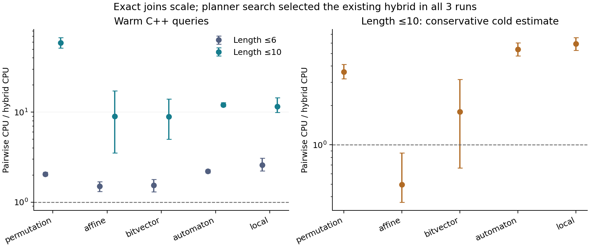

# Exact finite synthesis: measured results and a negative learning result

FX now searches for operation sequences from complete finite transition tables,
including irreversible operations. It emits an immutable certificate which an
independent verifier replays on **every** modeled state. This is implemented in
`@fx/core/discovery`, not just in an experiment-only interpreter.

The ambitious hypothesis was that FX could improve its own synthesis algorithm.
The current experiment does **not** establish that hypothesis: all three planner
search runs selected the existing hand-designed hybrid. We retained this negative
result and measured the underlying exact join in Python and optimized C++.

| Result | Measurement | Interpretation |
| --- | --- | --- |
| Primary held-out tasks | 320/320 solved; 40 domains | Five operation families, full 64-state semantics per task |
| Independent FX implementation | 396/396 verified | All 320 primary and 76 deeper synthesis tasks |
| Learned planner vs validation-selected strongest fixed planner | Identical in 3/3 runs | No demonstrated learned improvement; no finite discovery break-even |
| C++ length ≤6 warm join vs C++ pairwise | 1.93× [1.78, 2.10] | Supplemental audit after primary evaluation |
| C++ length ≤10 warm join vs C++ pairwise | 14.97× [10.43, 21.87] | Separately sealed scaling protocol, 19 non-saturated domains |
| Length ≤10 conservative cold estimate | 2.75× [1.73, 4.11] | Includes common semantic-bank cost and charges the complete shared C++ index to hybrid |
| Universal recovery example | 36 actions; no solution of length ≤35 | Known seven-state Černý example; full model recovery, no new theorem |

Intervals are paired domain-bootstrap 95% intervals, conditional on this single
host and fixed synthetic generators. Warm results exclude preprocessing. Cold
values are attributed CPU estimates, not independently measured fresh-process
latencies. The scaling study retains saturated `affine:2011` with zero eligible
targets. It does not silently replace that domain.



## Run the implemented capability

```sh
npm ci
python3 -m pip install -r research/exact_join/requirements.txt
npm run research:verify
```

This builds FX, checks exhaustive small-domain conformance, independently
reconstructs every retained primary and scaling task with the TypeScript API,
and runs the known recovery examples. Verification commands do not overwrite
retained evidence. Add `--record` to the individual Node scripts only to record
a new local verification run.

See [the API guide](../../docs/advanced/finite-synthesis.md) for integration.
For example, the recovery demonstration searches over `advance` and `merge`
transition tables, finds one sequence that works from every initial state, and
separately proves bounded impossibility at the preceding length.

## Reproduce the experiments

Python 3.12.14, NumPy 2.3.5, Matplotlib 3.10.8 and g++ are used in the retained
run; exact compiler and CPU information are in the JSON reports. Node v24.22.1
was used for independent FX verification; CI also checks Node 20.

The following commands rerun and **replace** the canonical experiment outputs.
Use an isolated checkout if you want to preserve the retained measurements.

```sh
python3 -m research.exact_join.learn
python3 -m research.exact_join.evaluate
python3 -m research.exact_join.analyze
python3 -m research.exact_join.native_audit
python3 -m research.exact_join.scaling
node research/exact_join/verify-fx.cjs --record
node research/exact_join/verify-fx.cjs --scaling --record
node research/exact_join/recovery.cjs --record
python3 -m research.exact_join.summarize
```

`learn` never loads final test cases. `evaluate` refuses changed selected sources
or a changed protocol. Selection hashes cover the Python files present at
selection time; later audit, scaling, plotting and FX implementation files are
additional work and are independently recorded in the artifact manifest.
Re-running learning can choose a different planner because native timing is noisy;
the recorded outcome describes these three runs, not a universal impossibility.

The primary source/protocol/winner seal was published in commit
[`34bc147`](https://github.com/skishore23/fx/commit/34bc147d5874a45acefcba99d583f62228ededef)
before final test execution. The deeper-study seal was published in
[`7f4a6dc`](https://github.com/skishore23/fx/commit/7f4a6dc9ccd5dee4e4fdde7480044780a7397816)
before scaling timings. Neither is a third-party preregistration service.

## Evidence map

| File | Contents |
| --- | --- |
| `protocol.json`, `results/freeze.json` | Primary hypothesis, splits, controls and selected-policy hashes |
| `results/selection.json` | Every candidate, training measurements, validation and discovery cost |
| `results/heldout.json`, `results/analysis.json` | All primary repeated timings, exact tasks and statistical analysis |
| `results/native-audit.json` | Compiled implementation audit on the primary tasks |
| `scaling-protocol.json`, `results/scaling.json` | New seeds, deeper tasks, native timings and saturation |
| `results/fx-verification.json`, `results/scaling-fx-verification.json` | Independently synthesized FX certificates for all 396 tasks |
| `results/recovery.json` | Bounded impossibility and recovery certificates for five, six and seven states |
| `results/overview.json`, `manifest.json` | Compact findings and hashes of the complete artifact |
| `paper.md` | Research manuscript draft with claims, proof, measurements and limitations |

## What this establishes

The exact inverse-image join is useful on these finite synthesis workloads, and
its advantage grows on the tested deeper tasks. Host implementation and index
amortization change the magnitude substantially. This is a concrete systems
finding. Meet-in-the-middle synthesis, inverse semantics, bitsets, and learned
search policies all have prior work. This artifact does not establish a new
general algorithm, autonomous coding-agent discovery, recursive self-improvement,
or production Beetle recovery. A paper submission still needs a defensible
novelty claim, application-derived workloads, and independent replication.
